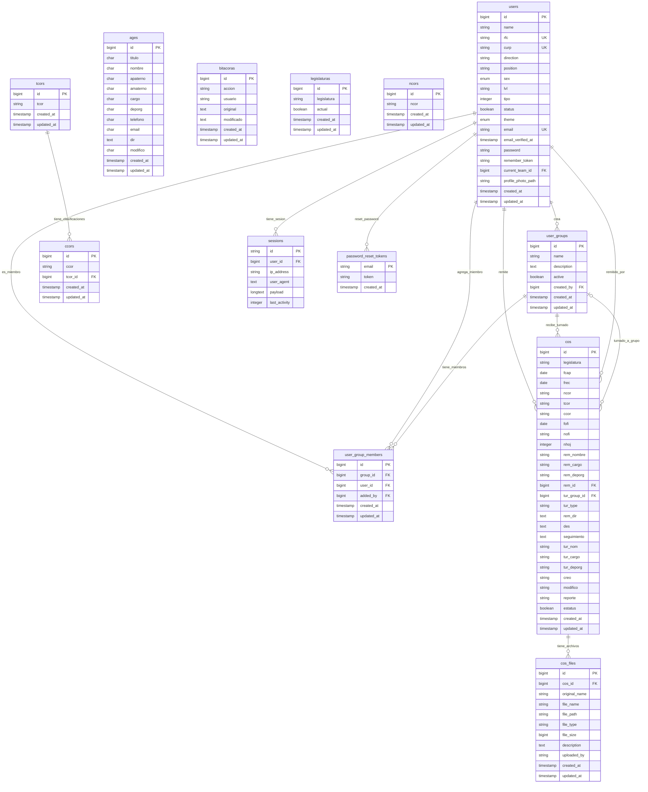

# Diagrama de Relaciones de Base de Datos

## Diagrama Mermaid

## Descripción de las Relaciones

### Tablas Principales

1. **users** - Tabla de usuarios del sistema
   - Campos principales: name, email, position, tipo (0=root, 1=admin, 2=supervisor, 3=personal)
   - Relaciones: Crea grupos, es miembro de grupos, remite documentos

2. **cos** - Tabla principal de correspondencia/documentos
   - Campos principales: legislatura, fechas, remitente, destinatario
   - Relaciones: Pertenece a usuario remitente, puede ser turnado a grupo o usuario

3. **user_groups** - Tabla de grupos de usuarios
   - Campos principales: name, description, active
   - Relaciones: Creado por usuario, tiene miembros, recibe documentos turnados

### Relaciones Many-to-Many

- **user_group_members** (Pivot): Conecta usuarios con grupos
  - Un usuario puede pertenecer a un solo grupo
  - Un grupo puede tener múltiples miembros

### Relaciones One-to-Many

- **cos_files**: Archivos adjuntos a documentos
- **sessions**: Sesiones de usuario
- **password_reset_tokens**: Tokens de recuperación de contraseña
- **ccors**: Clasificaciones que pertenecen a tipos de correspondencia

### Tablas de Catálogos

- **legislaturas**: Legislaturas disponibles
- **ncors**: Niveles de correspondencia
- **tcors**: Tipos de correspondencia  
- **ccors**: Clasificaciones de correspondencia
- **ages**: Información adicional de usuarios/contactos
- **bitacoras**: Log de cambios en el sistema

### Características Especiales

1. **Turnado flexible**: Los documentos pueden ser turnados a usuarios individuales o a grupos
2. **Restricción única**: Un usuario solo puede pertenecer a un grupo
3. **Auditoría**: Tabla de bitácoras para rastrear cambios
4. **Archivos adjuntos**: Sistema de archivos vinculado a documentos
5. **Sistema de roles**: Campo 'tipo' en users para control de acceso
